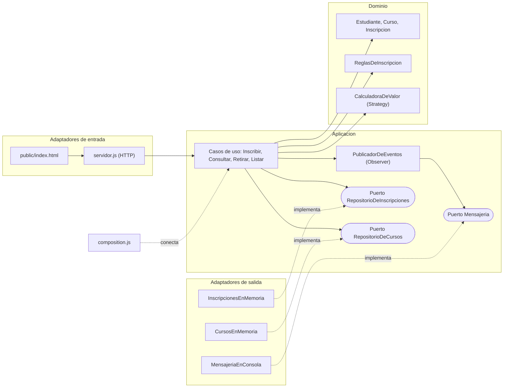

# Taller supletorio · Caso C · Luis Fernando Úsuga Higuita

Curso: IS066 Arquitectura de Sistemas · Grupo 2 · 2026-2 · Docente: Javier Darío Cardona Cárdenas  
Caso: **C · Inscripción a cursos** (entidad principal: Inscripción)

Partí del código espagueti de `original/inscripciones.js` y lo reorganicé con **Strategy** y **Observer** (patrones de diseño) dentro de una arquitectura **Hexagonal** (puertos y adaptadores).


## Cómo ejecutar

Necesito **Node.js 20 o superior** (probado con Node 22). No hay dependencias, así que no hace falta `npm install`.

```bash
git clone <URL-del-repositorio>
cd taller-supletorio-arquitectura-luisfernando
npm test        # corre las pruebas (node:test)
npm start       # levanta el servidor en http://localhost:3000
```

- Abrir `http://localhost:3000` muestra una página para inscribirse, ver la lista y retirarse.
- Para otro puerto: `PORT=4000 npm start` (en Windows PowerShell: `$env:PORT=4000; npm start`).
- El código original con los problemas está en `original/inscripciones.js` (no se ejecuta; es solo la línea base para la Parte 1).

### API

| Operación | Ruta | Respuesta |
|---|---|---|
| Crear inscripción | `POST /inscripciones` con `{"estudiante":{"nombre","correo","aprobados":[],"becado":false},"codigoCurso":"ARQ1","modalidad":"presencial"}` | 201 |
| Consultar | `GET /inscripciones/:id` | 200 / 404 |
| Retirar | `POST /inscripciones/:id/retirar` | 200 / 404 / 409 |
| Listar | `GET /inscripciones?estudiante=&curso=&estado=` | 200 |
| Cursos | `GET /cursos` | 200 |
| Informe de IA | `GET /informe-ia` | 200 (`informeUsoIA()`, código `ARQ-AMB-C`) |

Ejemplo:

```bash
curl -X POST localhost:3000/inscripciones -H "Content-Type: application/json" \
  -d '{"estudiante":{"nombre":"Ana Perez","correo":"ana@correo.co","becado":true},"codigoCurso":"ARQ1","modalidad":"virtual"}'
```

Errores: `400` dato inválido, `404` no existe, `409` rompe una regla (por ejemplo `SIN_CUPO`). Todos responden `{"codigo","mensaje"}`.
## Parte 1 · Principios

Antes de tocar nada ejecuté el código de `original/inscripciones.js` para ver qué pasa de verdad (no solo leerlo). Los números de línea de la tabla son los de ese archivo.

| # | Principio violado | Líneas del original | Qué pasa hoy (consecuencia concreta en este caso) | Cómo lo resolví (archivo y clase) |
|---|---|---|---|---|
| 1 | **SRP** (responsabilidad única) | 6 a 30 (`inscribir`) | Una sola función valida, busca el curso, cuenta cupos, calcula el valor, guarda, manda correos y pinta la pantalla. Si cualquiera de esas cosas cambia, hay que abrir la misma función. Además se nota en una falla real: ejecutada fuera del navegador guarda la inscripción y "envía" los dos correos, y **recién en la línea 29 revienta** con `ReferenceError: document is not defined`. Queda una inscripción guardada aunque la operación falló. | El caso de uso `InscribirEstudiante` (`src/application/casos-de-uso/InscribirEstudiante.js`) solo coordina. Las reglas están en `ReglasDeInscripcion` (`src/domain/ReglasDeInscripcion.js`), el precio en `CalculadoraDeValor` (`src/domain/precio/`) y los avisos en `NotificadorAlEstudiante` y `NotificadorACoordinacion` (`src/application/notificadores/`). |
| 2 | **OCP** (abierto/cerrado) | 22 a 25 | El valor se calcula con `if / else if` por modalidad y otro `if` por beca. Para agregar una modalidad nueva (por ejemplo "híbrida") hay que **modificar** `inscribir`, con el riesgo de romper lo que ya funcionaba. | Patrón Strategy: una clase por modalidad (`ModalidadPresencial`, `ModalidadVirtual`) y una por beca (`SinBeca`, `BecaPaga30`) en `src/domain/precio/`. Una modalidad nueva es un archivo nuevo (lo demuestro en la extensión). |
| 3 | **DIP** (inversión de dependencias) | 2 a 4, 10, 26, 27 a 29, 40 | La lógica de negocio depende de detalles concretos: arreglos globales (`inscripciones`, `cursos`), `console.log` como "correo" y `document.getElementById`. No hay forma de cambiar el almacenamiento o el canal de aviso sin reescribir la lógica. | Puertos (interfaces) en `src/application/puertos/` (`RepositorioDeInscripciones`, `RepositorioDeCursos`, `RepositorioDeEstudiantes`, `Mensajeria`) y adaptadores en `src/adapters/out/` (`InscripcionesEnMemoria`, `MensajeriaEnConsola`, etc.). Las dependencias se inyectan en `src/composition.js`. |
| 4 | **DRY** (no te repitas) | 7 y 8 con 33 y 34; 13, 14 y 36; 27 y 28 con 38 y 39 | La validación del estudiante y del código está copiada en `inscribir` y en `retirar`. La condición "misma inscripción, mismo estudiante, estado activa" aparece escrita 3 veces (líneas 13, 14 y 36). Si cambia una regla (por ejemplo, el largo mínimo del nombre) hay que acordarse de cambiarla en todos los sitios. | La validación vive una sola vez en las entidades `Estudiante` y `Curso` (`src/domain/`). La búsqueda de la inscripción activa está en un solo método, `InscripcionesEnMemoria.buscarActiva`. |
| 5 | **KISS** (hazlo simple) | 10, 12 a 17, 22 a 25 | Recorridos manuales con `for` y `var` para buscar; el conteo de inscritos y la revisión de duplicados van mezclados en el mismo ciclo; números mágicos sueltos (200000, 150000, 0.3, el 4 del código, el 3 del nombre). Y hay un bug de simplicidad: si la modalidad es desconocida (por ejemplo "nocturna") el `valor` se queda en 0 y **se inscribe gratis**, con correo incluido (línea 22 a 24). | Reglas separadas y legibles en `ReglasDeInscripcion.validar` (duplicado, cupo, prerrequisito, cada una en su paso). Búsquedas con `find` y `filter`. Los valores están con nombre dentro de cada estrategia. Una modalidad desconocida lanza el error `MODALIDAD_INVALIDA` en `CalculadoraDeValor`. |
| 6 | **Acoplamiento** | 29 y 40 | El negocio está pegado a la interfaz: `document.getElementById("res").innerHTML = ...` dentro de la regla. Solo funciona en un navegador, no se puede probar en Node (ver fila 1) y como arma HTML concatenando datos del usuario, un nombre como `<b>x</b>` se interpretaría como HTML. | El dominio no sabe que existe una pantalla. La entrada es el adaptador HTTP (`src/adapters/in/http/servidor.js`) y la página (`src/adapters/in/http/public/index.html`) dibuja con `textContent`, nunca con `innerHTML`. |
| 7 | **Cohesión** | 2 a 4 | `inscripciones` y `cursos` son variables globales que cualquier parte del programa puede tocar sin pasar por las reglas, y las funciones que las manejan están sueltas. Los datos y su comportamiento no viven juntos. | Cada entidad guarda sus datos y su comportamiento juntos (`Inscripcion.retirar()`, `Curso.cupo`, `Estudiante.haAprobado()`) en `src/domain/`. El estado del repositorio es privado dentro de `InscripcionesEnMemoria`. |
| 8 | **KISS** (errores claros) | 7, 8, 15, 18, 20, 33, 34 y 35 a 42 | Los errores se avisan con `console.log` y `return`, así que quien llama no puede saber si salió bien o mal: en mi prueba tanto el éxito como el error devuelven `undefined`. Hay casos que ni avisan: `retirar` sin inscripción no hace nada y no dice nada. Y otros revientan: un curso que no existe da `TypeError: Cannot read properties of null (reading 'cupo')` en la línea 18. | `ErrorDeDominio` con un código y un mensaje claro (`src/domain/errores.js`): `SIN_CUPO`, `YA_INSCRITO`, `FALTA_PRERREQUISITO`, `CURSO_NO_ENCONTRADO`, `INSCRIPCION_NO_ENCONTRADA`, etc. El adaptador HTTP los traduce a 400, 404 o 409. |

**Principios SOLID distintos que aparecen:** SRP (fila 1), OCP (fila 2) y DIP (fila 3). Además DRY (fila 4), KISS (filas 5 y 8), acoplamiento (fila 6) y cohesión (fila 7).


## Parte 2 · Patrones de diseño

Apliqué dos patrones de los que explica [refactoring.guru](https://refactoring.guru/es/design-patterns): **Strategy** para el valor de la inscripción y **Observer** para los avisos.

### Patrón 1 · Strategy (valor según modalidad y beca)

**Problema que resuelve.** En el original (líneas 22 a 25) el valor se calculaba con una cadena de `if` sobre la modalidad y otro `if` por la beca. Cada modalidad nueva obligaba a abrir ese bloque y tocarlo, y una modalidad desconocida (`"nocturna"`) terminaba cobrando $0 sin avisar.

**Cómo lo refactoricé.** Cada regla de precio quedó en su propia clase y una calculadora las usa sin saber cuál es cuál.

| Rol en refactoring.guru | Clase en mi código |
|---|---|
| Strategy (interfaz) | `src/domain/precio/EstrategiaDeModalidad.js` y `src/domain/precio/EstrategiaDeBeca.js` |
| Concrete Strategy | `ModalidadPresencial`, `ModalidadVirtual`, `SinBeca`, `BecaPaga30` (todas en `src/domain/precio/`) |
| Context | `CalculadoraDeValor` (`src/domain/precio/CalculadoraDeValor.js`) |
| Client | el caso de uso que arma y usa la calculadora (`src/application/casos-de-uso/InscribirEstudiante.js`, Parte 3) y `src/composition.js`, que decide qué estrategias se registran |

**Principio SOLID: Abierto/Cerrado (OCP).** Se agrega una modalidad creando una clase nueva y registrándola; la `CalculadoraDeValor` y las demás estrategias no se modifican.

### Patrón 2 · Observer (avisos al estudiante y a coordinación)

**Problema que resuelve.** En el original (líneas 27 a 29) la misma función que inscribe también armaba y enviaba los correos. Agregar un aviso nuevo (por ejemplo, auditoría) significaba editar la lógica de inscribir, y si un envío fallaba se podía dañar la inscripción.

**Cómo lo refactoricé.** El caso de uso solo publica un evento (`INSCRIPCION_CREADA` o `INSCRIPCION_RETIRADA`). Quien quiera enterarse se suscribe. Si un suscriptor falla, se registra el error y los demás siguen recibiendo el aviso.

| Rol en refactoring.guru | Clase en mi código |
|---|---|
| Publisher | `PublicadorDeEventos` (`src/application/eventos/PublicadorDeEventos.js`) |
| Subscriber (interfaz) | `Suscriptor` (`src/application/eventos/Suscriptor.js`) |
| Concrete Subscribers | `NotificadorAlEstudiante` y `NotificadorACoordinacion` (`src/application/notificadores/`) |
| Client | `src/composition.js`, que crea el publicador y suscribe a los notificadores; el caso de uso solo llama a `publicar` |

**Principio SOLID: Abierto/Cerrado y Responsabilidad Única.** Inscribir ya no sabe a quién se le avisa, y cada notificador hace una sola cosa. El envío real (correo, SMS) queda detrás del puerto `Mensajeria` (`src/application/puertos/Mensajeria.js`), que es Inversión de Dependencias.

**Pruebas:** `tests/precio.test.js` y `tests/eventos.test.js` (`npm test`).

## Parte 3 · Arquitectura

Elegí **arquitectura hexagonal (puertos y adaptadores)**.

### Diagrama



Las flechas de dependencia van hacia adentro: el dominio no conoce a nadie, la aplicación solo conoce el dominio y los puertos, y los adaptadores conocen a la aplicación. `src/composition.js` es el único sitio que une las piezas concretas.

### Estructura de carpetas

```
original/                      codigo espagueti (Parte 1)
src/
  domain/                      reglas del negocio, sin dependencias externas
    Estudiante.js  Curso.js  Inscripcion.js
    ReglasDeInscripcion.js  errores.js  informeUsoIA.js
    precio/                    Strategy (Parte 2)
  application/
    casos-de-uso/              Inscribir, Consultar, Retirar, Listar, ListarCursos
    puertos/                   RepositorioDeInscripciones, RepositorioDeCursos, Mensajeria
    eventos/ notificadores/    Observer (Parte 2)
  adapters/
    in/http/servidor.js        HTTP -> casos de uso
    out/                       InscripcionesEnMemoria, CursosEnMemoria, MensajeriaEnConsola
  composition.js               raiz de composicion
  index.js                     arranque
public/index.html              pagina minima
tests/                         pruebas con node:test
```

### Operaciones y regla de negocio

Las cuatro operaciones pedidas son: **crear** (`POST /inscripciones`), **consultar** (`GET /inscripciones/:id`), **retirar** (`POST /inscripciones/:id/retirar`) y **listar** (`GET /inscripciones`).

La regla principal es **no inscribir si no hay cupo**: `ReglasDeInscripcion.exigirCupo` lanza `SIN_CUPO` y el servidor responde `409` con un mensaje claro. También se validan duplicado (`YA_INSCRITO`), prerrequisito (`FALTA_PRERREQUISITO`), modalidad y datos de entrada. Esta lógica está solo en el dominio y los casos de uso; ni el servidor ni el repositorio deciden nada del negocio.

### Por qué hexagonal y por qué no MVC

Para este caso pesé dos atributos de calidad:

- **Testeabilidad.** Las reglas (cupo, prerrequisito, valor) y los casos de uso se prueban sin levantar un servidor ni una base de datos, porque las dependencias entran por puertos y en las pruebas pongo una mensajería falsa. Por eso `tests/inscripcion.test.js` corre en milisegundos.
- **Portabilidad / mantenibilidad.** Cambiar cómo se guardan los datos o cómo se envían los avisos solo toca un adaptador, no las reglas.

Descarté **MVC** porque, tal como lo usé en el curso, el controlador termina recibiendo la lógica (y eso me costaba justamente el descuento de "lógica de negocio en el controlador"), y el modelo queda pegado al framework y a la base de datos. En hexagonal la separación entre negocio y detalles técnicos viene obligada por los puertos. Descarté también una arquitectura en capas simple porque no impide que la capa de negocio importe directamente el acceso a datos.

### ¿Qué archivos cambian si paso de memoria a base de datos?

- **Se agrega:** un adaptador nuevo, por ejemplo `src/adapters/out/InscripcionesEnPostgres.js` (y `CursosEnPostgres.js`), que implementa los mismos puertos `RepositorioDeInscripciones` y `RepositorioDeCursos`.
- **Se modifica:** solo `src/composition.js` (cambiar `new InscripcionesEnMemoria()` por el adaptador nuevo).
- **No cambia nada de:** `src/domain/`, `src/application/` ni `src/adapters/in/`. Los casos de uso no se enteran.
- Una nota honesta: con base de datos real, la regla de cupo debería protegerse con una transacción, porque con varias peticiones a la vez el conteo y el guardado podrían cruzarse. En memoria, con un solo proceso, no es un problema práctico.
